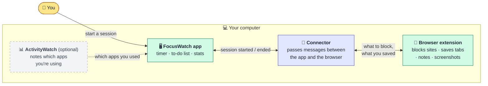
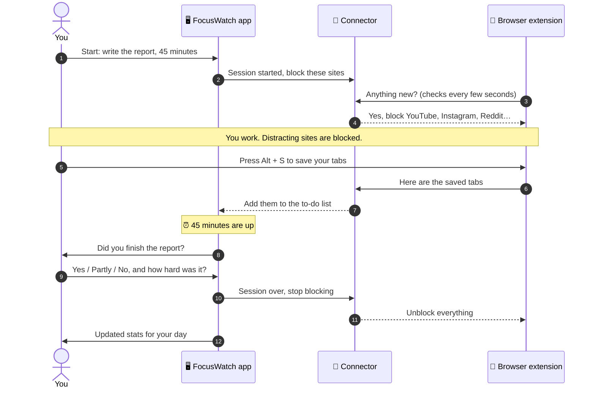
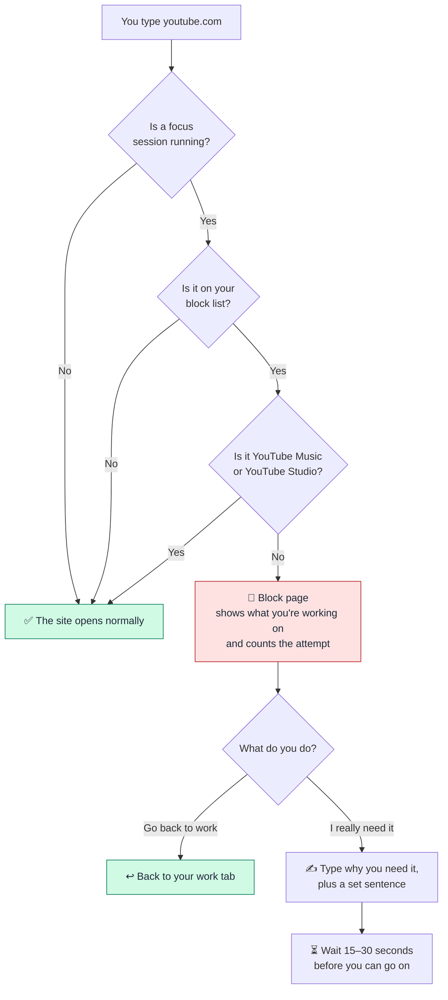
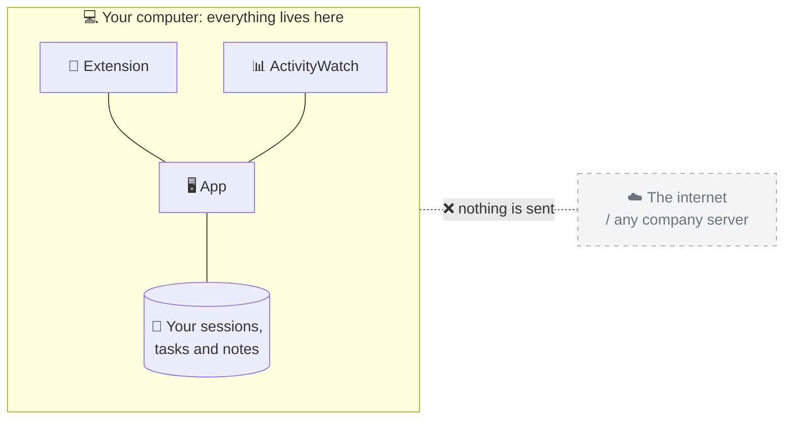
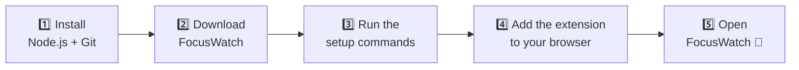

# FocusWatch

**Blocks your distractions during a focus session, then shows you where your hours actually went, all on your own machine. I've used it daily for [X] months: [N] sessions and [H] hours of deep work logged.**

<!-- Replace the [X]/[N]/[H] placeholders above with your real numbers, and add a screenshot or GIF at docs/images/demo.gif -->


FocusWatch is a free focus app for your computer. You tell it what you're about to work on and for how long. While the timer runs, it blocks sites like YouTube, Instagram and Reddit, and afterwards it asks whether you actually finished what you planned.

No sign-up, no subscription. Everything stays on your computer.

---

## What you get

### 🖥️ The app

- **Focus sessions.** Write what you'll get done ("finish the intro slides"), pick a time, press start. When the time is up, say honestly whether you did it.
- **A to-do list** with colour-coded categories. Paste in a whole list at once and it splits it into tasks.
- **Your day at a glance.** How much time went to real work and how much to distractions, plus your top apps and websites.
- **Trends over time.** A calendar-style chart of your best focus hours, your streaks, and which kinds of work you do best.
- **A small floating timer** that stays on top of your other windows.
- **Ready-made AI prompts.** One click copies a summary of your session that you can paste into ChatGPT, Claude or any other assistant. FocusWatch never contacts an AI itself.

### 🧩 The browser extension (Chrome or Edge)

- **Blocks distracting sites** while a session is running and reminds you what you're meant to be doing.
- **Keeps YouTube Music and YouTube Studio open**, so music and creator work aren't blocked.
- **`Alt + S`** saves all your open tabs to your to-do list and closes them.
- **`Alt + Shift + C`** takes a screenshot of your work as proof for the session.
- **`Alt + N`** opens a quick notepad on any page.
- **Nudges you** when you're jumping between tabs too fast, and reminds you to rest your eyes every 50 minutes.

---

## How it works

FocusWatch has three pieces. You only ever look at the first two; the third runs quietly in the background.



- **The app** is where you plan and review your work.
- **The extension** lives in your browser and does the blocking.
- **The connector** is a tiny background program that lets the two talk to each other. It starts automatically when you open FocusWatch.
- **ActivityWatch** is a separate free app. It's optional, but without it the "where did my time go" charts stay empty.

### A focus session, start to finish



### What happens when you open a blocked site



Getting past the block is possible, but slow on purpose, so you stop and think before giving in. Each attempt is counted, so at the end of the day you can see how often you reached for a distraction.

### Your data stays on your computer



There are no accounts, analytics or cloud sync. FocusWatch never sends your data anywhere.

---

## Install

### What you need first

| | |
|---|---|
| 💻 **Computer** | Windows 10 or 11. Mac and Linux work too, with [a couple of extra steps](#mac-and-linux). |
| 🌐 **Browser** | Google Chrome or Microsoft Edge |
| 🟩 **Node.js** | Free. Download the "LTS" version from [nodejs.org](https://nodejs.org) and install it like any other program. |
| 🐙 **Git** | Free. Download it from [git-scm.com](https://git-scm.com). |
| 📊 **ActivityWatch** *(optional)* | Free. Download it from [activitywatch.net](https://activitywatch.net) if you want the "where did my time go" charts. |

### The steps at a glance



### Easiest: let an AI assistant do it

If you use an AI coding assistant such as Claude Code, Cursor or Codex, open it in the folder where you want FocusWatch and paste in the prompt below. It does steps 2, 3 and 5 for you and walks you through step 4.

```text
Install FocusWatch (https://github.com/LuciferSharma/focus) on this machine. Follow these steps in order, and stop and tell me if any step fails.

1. Check prerequisites by running `node -v`, `git --version`, and `pnpm -v`.
   - Node.js must be version 20 or newer. If it is missing or too old, stop and ask me to install it from https://nodejs.org. Do not install it yourself.
   - If pnpm is missing, run `corepack enable`. If that fails, run `npm install -g pnpm`.
2. Clone the repo: `git clone https://github.com/LuciferSharma/focus.git` and `cd focus`.
3. Install dependencies: `pnpm install`.
4. Build the shared packages and the browser extension: `pnpm setup`.
   Confirm that `apps/extension/dist/manifest.json` now exists.
5. Check whether ActivityWatch is running by requesting http://127.0.0.1:5600/api/0/info.
   If it is not reachable, tell me ActivityWatch is optional but recommended, and link https://activitywatch.net.
6. On Windows, create a desktop shortcut:
   `powershell -NoProfile -ExecutionPolicy Bypass -File launcher\Create-Desktop-Shortcut.ps1`
7. Start FocusWatch:
   - Windows: `wscript launcher\FocusWatch.vbs`
   - macOS/Linux: run `node apps/desktop/bridge-standalone.cjs` in the background, then `pnpm dev:desktop`.
8. Verify it is running: http://127.0.0.1:47777/health should return {"status":"ok",...}, and http://localhost:1420 should load.
9. You cannot load the browser extension for me, so give me these instructions with the full absolute path filled in:
   - Open chrome://extensions (or edge://extensions)
   - Turn on "Developer mode"
   - Click "Load unpacked" and select the folder <absolute path to>/focus/apps/extension/dist
   - Pin the FocusWatch icon. Its popup should show ONLINE once the app is running.

When finished, summarize what was installed, where it is, and how to start and stop FocusWatch.
```

### Or do it yourself

**Step 1: Install Node.js and Git** from the links in the table above.

**Step 2 and 3: Download FocusWatch and set it up.** Open a terminal (on Windows, press `Win`, type **PowerShell**, press Enter), then paste these lines one at a time:

```powershell
git clone https://github.com/LuciferSharma/focus.git
cd focus
corepack enable
pnpm install
pnpm setup
```

This takes a few minutes the first time. When it's done you'll have a `focus` folder in your home folder.

**Step 4: Add the extension to your browser.**

1. In Chrome, go to `chrome://extensions` (in Edge, `edge://extensions`).
2. Turn on **Developer mode** with the switch in the top-right corner.
3. Click **Load unpacked**.
4. Open the `focus` folder, then `apps` → `extension` → `dist`, and click **Select folder**.
5. Click the puzzle-piece icon in the toolbar and pin FocusWatch so it's always visible.

**Step 5: Open FocusWatch.** In the `focus` folder, open `launcher` and double-click **FocusWatch.vbs**. The first start can take up to a minute.

To get a FocusWatch icon on your desktop, run this once in the terminal from the `focus` folder:

```powershell
powershell -NoProfile -ExecutionPolicy Bypass -File launcher\Create-Desktop-Shortcut.ps1
```

**Check it worked:** click the FocusWatch icon in your browser toolbar. It should say **ONLINE**.

### Mac and Linux

The double-click launcher is Windows-only. On Mac or Linux, open two terminal windows in the `focus` folder and run one line in each:

```bash
node apps/desktop/bridge-standalone.cjs
pnpm dev:desktop
```

Then open <http://localhost:1420> in your browser.

---

## Everyday use

1. Open FocusWatch from the desktop icon.
2. Add a task, or go straight to starting a session.
3. Write what you'll finish, pick a time, and choose whether to block websites.
4. Work. The floating timer shows how long you have left.
5. When the time's up, say whether you finished, then check your stats.

**To close FocusWatch completely,** right-click `launcher\Stop-FocusWatch.ps1` and choose **Run with PowerShell**.

### Where your data is saved

- Your **sessions, tasks and settings** are saved inside your browser. ⚠️ If you clear your browser's site data for `localhost`, they'll be erased.
- The **session that's currently running** is also saved in a file, so it survives a restart.
- The **app history** recorded by ActivityWatch stays in ActivityWatch.

---

## Something not working?

| What you see | What to do |
|---|---|
| The extension says **OFFLINE** | FocusWatch isn't running. Open it from the desktop icon, then click **Force resync** in the extension. If it still says OFFLINE, run `launcher\Restart-Bridge.ps1`. |
| **"Port 1420 is already in use"** | FocusWatch is already open. Run `launcher\Stop-FocusWatch.ps1`, then open it again. |
| The time charts are **empty** | ActivityWatch isn't installed or isn't running. Start it, then check the **Diagnostics** page in FocusWatch. |
| **"Dependencies are not installed"** | Run `pnpm install` and then `pnpm setup` in the `focus` folder. |
| Blocking doesn't work | Make sure the extension is turned on in `chrome://extensions` and the session has **Block websites** ticked. |

---

## What I'd do differently

<!-- Draft based on the current code. Rewrite in your own words. -->

- **Write the connector once.** I ended up with three versions of it (one for development, one standalone, one for the native app). They drifted apart, and keeping them in sync is a pain.
- **Use a proper database from the start.** Saving everything inside the browser was quick to build, but clearing your browser data wipes your history.
- **Pick one way to run the app.** I started building a native desktop app, then switched to running it in a browser window because it was faster to iterate on. The native version is now half-finished and the launcher only works on Windows.
- **Keep files small.** Some screens grew past 1,000 lines of code, which makes every change riskier.
- **Ship less, sooner.** The extension collected lots of extras: tab sleeping, eye breaks, a notepad, and a page cleaner that's now switched off. The part I actually use every day is simple: start a session, block distractions, check whether I delivered.

---

## For developers

<details>
<summary><b>Tech stack, project layout and commands</b></summary>

### Tech stack

| Part | Built with |
|---|---|
| App | React 19, TypeScript, Vite, Tailwind CSS, Zustand, Recharts |
| Extension | Chrome Manifest V3, React |
| Connector | Plain Node.js HTTP server on `127.0.0.1:47777` (no dependencies) |
| Activity data | [ActivityWatch](https://activitywatch.net) REST API on port `5600` |
| Shared logic | pnpm workspace packages (site rules, focus score, event processing, types) |
| Native app *(experimental)* | Tauri 2 (Rust) + SQLite |
| Tests | Vitest |

### Project layout

```text
apps/
  desktop/      the app (React), the connector (bridge-standalone.cjs), native shell (src-tauri/)
  extension/    the browser extension
packages/
  shared-types/         shared TypeScript types
  domain-rules/         URL cleaning and site classification
  score-engine/         focus score and tab-switching analysis
  activity-normalizer/  turns ActivityWatch data into activity records
launcher/       Windows start / stop scripts
tests/          automated tests
docs/           original design spec and build plan
```

### Commands

```bash
pnpm test              # run the tests
pnpm build:packages    # rebuild the shared packages after changing them
pnpm dev:extension     # rebuild the extension whenever you save
pnpm dev:desktop       # run the app with live reload
```

After rebuilding the extension, click **Reload** on it in `chrome://extensions`.

### Ports

| Port | What uses it |
|---|---|
| `1420` | The app |
| `47777` | The connector |
| `5600` | ActivityWatch |

### Native desktop app (experimental)

`apps/desktop/src-tauri` wraps the same app in a native window using [Tauri](https://tauri.app). It needs [Rust and the Tauri prerequisites](https://tauri.app/start/prerequisites/). Run it with `cd apps/desktop && pnpm tauri dev`.

</details>

---

## Contributing

Issues and pull requests are welcome. Please run `pnpm test` before opening a pull request.

To make sure no passwords or API keys ever get committed, the repo includes a [gitleaks](https://github.com/gitleaks/gitleaks) check that runs before every commit. Turn it on once after cloning:

```bash
git config core.hooksPath .githooks
```

The same check also runs on GitHub for every push and pull request.

## License

[MIT](LICENSE). Free to use, change and share.
