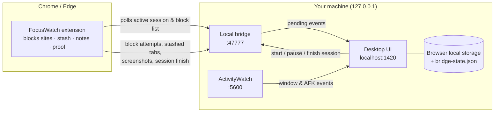

# FocusWatch

**Blocks your distractions during a focus session, then shows you where your hours actually went, all on your own machine. I've used it daily for [X] months: [N] sessions and [H] hours of deep work logged.**

<!-- Replace the [X]/[N]/[H] placeholders above with your real numbers, and add a screenshot or GIF at docs/images/demo.gif -->


It's a local-first deep-work tracker, website blocker, and accountability companion. No accounts, no cloud, no telemetry.

FocusWatch has two parts that work together:

- **Desktop app** — start focus sessions, track tasks, and review where your time actually went.
- **Browser extension** (Chrome / Edge) — blocks distracting sites while a session is running and adds a few focus tools to the browser.

They talk to each other through a small local bridge server on `127.0.0.1:47777`. Nothing leaves your computer.

## Features

**Desktop app**
- Focus sessions with a planned duration, an expected output, pause/resume, and an end-of-session check on whether you actually delivered it
- Task list with categories and batch import from Markdown / plain-text lists
- Today dashboard: deep work vs. distracted time, focus score, top apps and sites, full activity log
- Analytics: deep-work heatmap, behavior patterns, per-category insights, streaks
- Always-on-top floating timer widget
- Copy-ready AI prompts for session summaries and task planning — paste them into any AI assistant you like (FocusWatch itself makes no AI or network calls)
- Diagnostics screen showing ActivityWatch, bridge, and extension status

**Browser extension**
- Blocks your distraction list during a session, with a block page that reminds you what you're working on
- Built-in exceptions for `music.youtube.com` and `studio.youtube.com`
- Tab stash (`Alt+S`) — save all open tabs to your task backlog and close them
- Proof capture (`Alt+Shift+C`) — screenshot your work as evidence for the session
- Note drawer (`Alt+N`) — quick notes on any page
- Warning when you switch tabs too fast during a session
- 20-20-20 eye-break reminder, and automatic sleeping of tabs left idle for 30+ minutes

## Tech stack

| Layer | Tech |
|---|---|
| Desktop UI | React 19, TypeScript, Vite 6, Tailwind CSS, Zustand, Recharts |
| Browser extension | Manifest V3, `declarativeNetRequest` blocking, React popup, Shadow DOM content scripts |
| Local bridge | Node.js HTTP server (zero dependencies) on `127.0.0.1:47777` |
| Activity tracking | [ActivityWatch](https://activitywatch.net) REST API |
| Shared logic | pnpm workspace packages: domain rules, focus score engine, event normalizer, Zod types |
| Native shell *(experimental)* | Tauri 2 (Rust) + SQLite |
| Tests | Vitest (73 tests) |

## How it fits together



The desktop UI owns the data. The bridge is a small relay that holds the current session state, so the extension knows what to block and anything captured in the browser (tabs, notes, proof screenshots) makes it back to the app.

## Requirements

| | |
|---|---|
| **OS** | Windows 10 / 11. The one-click launcher is Windows-only — see [macOS / Linux](#macos--linux) for manual steps. |
| **Node.js** | 20 or newer — <https://nodejs.org> |
| **pnpm** | Comes with Node through Corepack (`corepack enable`), or `npm install -g pnpm` |
| **Git** | <https://git-scm.com> |
| **Browser** | Google Chrome or Microsoft Edge |
| **ActivityWatch** *(recommended)* | <https://activitywatch.net> — powers automatic app and window tracking for the dashboard. Sessions, tasks, and blocking work without it, but the activity charts will be empty. |

## Installation

### Option A: Let an AI coding agent install it

If you use an AI coding agent (Claude Code, Cursor, Codex, etc.), open it in the folder where you want FocusWatch installed and paste this prompt:

```text
Install FocusWatch (https://github.com/LuciferSharma/focus) on this machine. Follow these steps in order, and stop and tell me if any step fails.

1. Check prerequisites by running `node -v`, `git --version`, and `pnpm -v`.
   - Node.js must be version 20 or newer. If it is missing or too old, stop and ask me to install it from https://nodejs.org. Do not install it yourself.
   - If pnpm is missing, run `corepack enable`. If that fails, run `npm install -g pnpm`.
2. Clone the repo: `git clone https://github.com/LuciferSharma/focus.git` and `cd focus`.
3. Install dependencies: `pnpm install`.
4. Build the shared packages and the browser extension: `pnpm setup`.
   Confirm that `apps/extension/dist/manifest.json` now exists.
5. Check whether ActivityWatch is running by requesting http://127.0.0.1:5600/api/0/info.
   If it is not reachable, tell me ActivityWatch is optional but recommended, and link https://activitywatch.net.
6. On Windows, create a desktop shortcut:
   `powershell -NoProfile -ExecutionPolicy Bypass -File launcher\Create-Desktop-Shortcut.ps1`
7. Start FocusWatch:
   - Windows: `wscript launcher\FocusWatch.vbs`
   - macOS/Linux: run `node apps/desktop/bridge-standalone.cjs` in the background, then `pnpm dev:desktop`.
8. Verify it is running: http://127.0.0.1:47777/health should return {"status":"ok",...}, and http://localhost:1420 should load.
9. You cannot load the browser extension for me, so give me these instructions with the full absolute path filled in:
   - Open chrome://extensions (or edge://extensions)
   - Turn on "Developer mode"
   - Click "Load unpacked" and select the folder <absolute path to>/focus/apps/extension/dist
   - Pin the FocusWatch icon. Its popup should show ONLINE once the app is running.

When finished, summarize what was installed, where it is, and how to start and stop FocusWatch.
```

### Option B: Install manually

**1. Clone and build**

```powershell
git clone https://github.com/LuciferSharma/focus.git
cd focus
corepack enable        # only needed once, if you don't already have pnpm
pnpm install
pnpm setup             # builds the shared packages and the browser extension
```

**2. Load the browser extension**

1. Open `chrome://extensions` (or `edge://extensions` in Edge).
2. Turn on **Developer mode** (top-right toggle).
3. Click **Load unpacked** and select the `apps/extension/dist` folder inside the repo.
4. Pin the FocusWatch icon to your toolbar.

**3. Start the app**

Double-click `launcher\FocusWatch.vbs`. It starts the bridge and the UI in the background, then opens FocusWatch in its own window. The first launch can take up to a minute.

To get a desktop shortcut with the FocusWatch icon:

```powershell
powershell -NoProfile -ExecutionPolicy Bypass -File launcher\Create-Desktop-Shortcut.ps1
```

Once the app is running, the extension popup should switch from **OFFLINE** to **ONLINE**.

**4. (Recommended) Set up ActivityWatch**

Install [ActivityWatch](https://activitywatch.net) and leave it running. FocusWatch reads from it at `127.0.0.1:5600` to show which apps and windows you used. For per-URL browser tracking, also install the ActivityWatch [web watcher extension](https://github.com/ActivityWatch/aw-watcher-web).

## Usage

1. Open FocusWatch and add a task, or start a session straight away.
2. Click **Start session**, describe the output you'll produce, pick a duration, and choose whether to block websites.
3. Work. Blocked sites redirect to the FocusWatch block page, and the floating widget keeps the timer visible.
4. When the session ends, confirm whether you delivered the output, then review your day on the dashboard.

### Launcher scripts (Windows)

| Script | What it does |
|---|---|
| `launcher\FocusWatch.vbs` | Starts everything and opens the app window. Safe to run again if it's already running. |
| `launcher\Stop-FocusWatch.ps1` | Stops the bridge and UI servers. |
| `launcher\Restart-Bridge.ps1` | Restarts only the bridge. A running session survives. |
| `launcher\Create-Desktop-Shortcut.ps1` | Creates the desktop shortcut. |

Logs are written to `launcher\logs\`.

### macOS / Linux

The launcher scripts are Windows-only, but the app itself is cross-platform. Run these from the repo root in two terminals:

```bash
node apps/desktop/bridge-standalone.cjs   # extension bridge on 127.0.0.1:47777
pnpm dev:desktop                          # UI on http://localhost:1420
```

Then open <http://localhost:1420>.

## Where your data lives

- **Sessions, tasks, and settings** are stored in your browser's local storage for `http://localhost:1420`. Clearing that site's data in your browser will erase them.
- **The active session and pending screenshots** are kept by the bridge in `apps/desktop/bridge-state.json` and `apps/desktop/bridge-artifacts/`.
- **Activity history** stays in ActivityWatch's own local database.

All of these files are git-ignored. FocusWatch makes no outbound network requests.

## Ports

| Port | Used by |
|---|---|
| `1420` | FocusWatch UI |
| `47777` | Local bridge between the app and the extension |
| `5600` | ActivityWatch (optional) |

## Troubleshooting

- **Extension shows OFFLINE** — the bridge isn't running. Start FocusWatch, or run `launcher\Restart-Bridge.ps1`, then click **Force resync** in the popup.
- **"Port 1420 is already in use"** — FocusWatch is probably already running. Run `launcher\Stop-FocusWatch.ps1` and launch it again.
- **Empty activity charts** — ActivityWatch isn't running or isn't reachable at `127.0.0.1:5600`. The Diagnostics screen shows what's connected.
- **"Dependencies are not installed"** — run `pnpm install` and `pnpm setup` in the repo root.
- **Extension changes not taking effect** — after `pnpm build:extension`, click **Reload** on the extension in `chrome://extensions`.

## Development

```bash
pnpm test              # run the test suite (vitest)
pnpm build:packages    # rebuild the shared packages after changing them
pnpm dev:extension     # rebuild the extension on every change
pnpm dev:desktop       # UI dev server with hot reload
```

### Project structure

```text
apps/
  desktop/        React + Vite UI, local bridge (bridge-standalone.cjs), Tauri shell (src-tauri/)
  extension/      Manifest V3 extension for Chrome / Edge
packages/
  shared-types/         shared TypeScript types and Zod schemas
  domain-rules/         URL sanitizing, domain parsing, site classification
  score-engine/         focus score and context-switching analysis
  activity-normalizer/  turns ActivityWatch events into activity records
launcher/         Windows launch / stop scripts
tests/            vitest suite
docs/             original product spec and implementation plan
```

### Native desktop build (experimental)

`apps/desktop/src-tauri` contains a [Tauri 2](https://tauri.app) shell that wraps the same UI in a native window and stores data in SQLite. It requires the [Rust toolchain and Tauri prerequisites](https://tauri.app/start/prerequisites/). The browser-based launcher above is the supported way to run FocusWatch.

```bash
cd apps/desktop
pnpm tauri dev
```

## What I'd do differently

<!-- Draft based on the current code. Rewrite in your own words. -->

- **One bridge instead of three.** The extension bridge exists as a Vite dev plugin, a standalone Node server, and a Rust/warp server inside Tauri. They drifted apart, and the launcher has to make sure the right one wins port 47777. I'd write it once and have every runtime share it.
- **A real database from day one.** In browser mode, sessions and tasks live in `localStorage`, so clearing site data wipes your history. I'd use SQLite (or IndexedDB at minimum) everywhere, not only in the Tauri build.
- **Commit to one runtime.** I started with Tauri, then ended up running the UI in a Chrome app window through a PowerShell launcher because it was faster to iterate on. That left the native build half-maintained and the launcher Windows-only.
- **Smaller components.** Some screens grew past 1,000 lines (`TaskListScreen.tsx`). Splitting them early would have made changes much less risky.
- **Fewer features, sooner.** The extension picked up tab aging, eye breaks, a note drawer, and a DOM sanitizer, which is now disabled. The core loop (start session → block → verify output) is what I actually use every day.

## Contributing

Issues and pull requests are welcome. Please run `pnpm test` before opening a PR.

The repo includes a pre-commit hook that runs [gitleaks](https://github.com/gitleaks/gitleaks) so secrets never get committed. Enable it once after cloning:

```bash
git config core.hooksPath .githooks
```

CI runs the same gitleaks scan on every push and pull request.

## License

[MIT](LICENSE)
